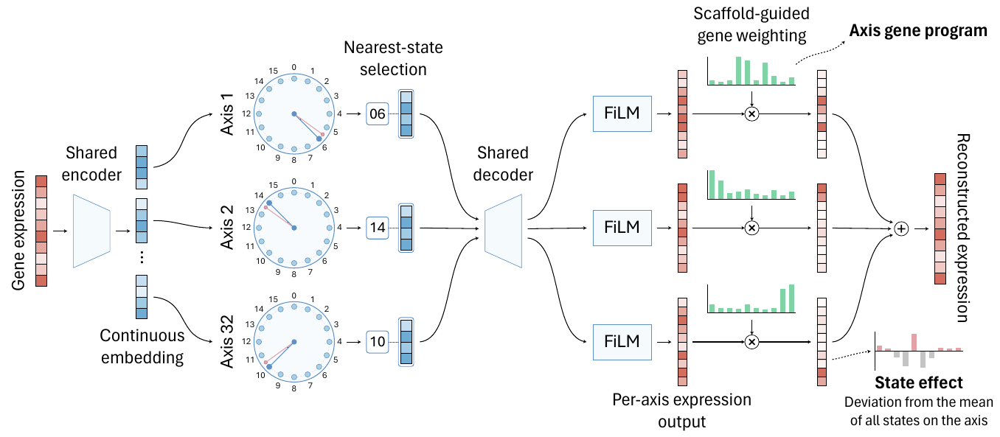

# LEXA

**Learning a lexicon of gene-programme states from single-cell transcriptomes**

LEXA represents each cell by one categorical state on each of 32 gene-programme axes. Each axis has 16 states, giving a 128-bit compositional representation. A scaffold-guided additive decoder associates every selected state with an explicit signed contribution in gene space.

<p align="center">
  
</p>

## Repository structure

- `lexa/`: model, scaffold construction, training, code extraction and state-effect computation
- `data_pipeline/`: H5AD preprocessing, donor-disjoint splitting and data loading
- `benchmark/`: representation comparators used in the paper

## Installation

LEXA requires Python 3.10 or later and a CUDA-enabled PyTorch installation for training.

```bash
git clone https://github.com/lexa2026/LEXA.git
cd LEXA
pip install -r requirements.txt
```

Comparator scripts require their official packages:

```bash
pip install cnmf harmonypy scvi-tools scSpectra
```

## Quick start

The following example fits LEXA de novo to one or more H5AD files. Input matrices should contain raw counts, and donor and cell-type fields should be available in `adata.obs`.

```bash
export LEXA_OUTPUT_ROOT=/path/to/lexa_runs

python -m data_pipeline.prepare_atlas \
  --config lexa/lexa_r4.yaml \
  --run-id cohort_data \
  --h5ad-dir /path/to/h5ad \
  --split-group-key donor_id \
  --donor-key donor_id \
  --cell-type-key cell_type

python -m lexa.build_scaffold \
  --config lexa/lexa_r4.yaml \
  --data-run-id cohort_data \
  --output-dir "$LEXA_OUTPUT_ROOT/cohort_scaffold"

export LEXA_SCAFFOLD_PATH="$LEXA_OUTPUT_ROOT/cohort_scaffold/module_mask_prior.npz"

python -m lexa.train \
  --config lexa/lexa_r4.yaml \
  --data-run-id cohort_data \
  --run-id cohort_model \
  --require-cuda

python -m lexa.extract_codes \
  --config lexa/lexa_r4.yaml \
  --data-run-id cohort_data \
  --run-id cohort_model \
  --checkpoint best

python -m lexa.compute_state_effects \
  --config lexa/lexa_r4.yaml \
  --run-id cohort_model \
  --checkpoint best
```

## Weights and data access

Model weights are available from the [LEXA-weights Hugging Face repository](https://huggingface.co/crystaiiise/LEXA-weights). The four cohort checkpoints were fitted independently from random initialization on their respective datasets.

| Model | Training data | Data access | Citation | Checkpoint |
|---|---|---|---|---|
| Atlas LEXA | 210 human scRNA-seq datasets from CZ CELLxGENE Discover | [CZ CELLxGENE Discover](https://cellxgene.cziscience.com/) | [CZI Cell Science Program et al., 2025](https://doi.org/10.1093/nar/gkae1142) | [`atlas_checkpoint.pt`](https://huggingface.co/crystaiiise/LEXA-weights/resolve/main/atlas_checkpoint.pt) |
| OneK1K LEXA | OneK1K PBMC cohort | [CELLxGENE dataset](https://cellxgene.cziscience.com/e/3faad104-2ab8-4434-816d-474d8d2641db.cxg/) | [Yazar et al., 2022](https://doi.org/10.1126/science.abf3041) | [`onek1k_checkpoint.pt`](https://huggingface.co/crystaiiise/LEXA-weights/resolve/main/onek1k_checkpoint.pt) |
| SLE LEXA | SLE PBMC cohort | [CELLxGENE dataset](https://cellxgene.cziscience.com/e/218acb0f-9f2f-4f76-b90b-15a4b7c7f629.cxg/) | [Perez et al., 2022](https://doi.org/10.1126/science.abf1970) | [`sle_checkpoint.pt`](https://huggingface.co/crystaiiise/LEXA-weights/resolve/main/sle_checkpoint.pt) |
| COVID-A LEXA | Adult COVID-19 PBMC/CITE-seq cohort | [CELLxGENE dataset](https://cellxgene.cziscience.com/e/c7775e88-49bf-4ba2-a03b-93f00447c958.cxg/) | [Stephenson et al., 2021](https://doi.org/10.1038/s41591-021-01329-2) | [`covid_a_checkpoint.pt`](https://huggingface.co/crystaiiise/LEXA-weights/resolve/main/covid_a_checkpoint.pt) |
| COVID-B LEXA | Independent paediatric and adult COVID-19 PBMC cohort | [CELLxGENE dataset](https://cellxgene.cziscience.com/e/2a498ace-872a-4935-984b-1afa70fd9886.cxg/) | [Yoshida et al., 2022](https://doi.org/10.1038/s41586-021-04345-x) | [`covid_b_checkpoint.pt`](https://huggingface.co/crystaiiise/LEXA-weights/resolve/main/covid_b_checkpoint.pt) |

All checkpoints use the shared 10,310-gene vocabulary described in the paper.
