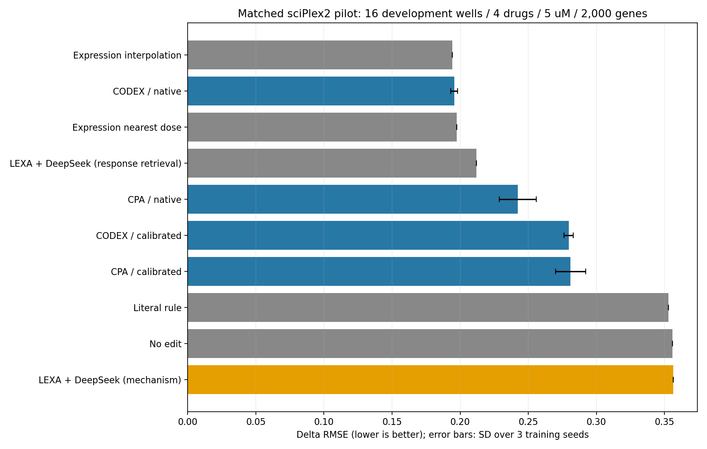

# CellPalyer

基于 **LEXA 离散细胞编码＋DeepSeek 文字决策**的单细胞药物扰动预测实验，以及同一数据协议下的 CPA、CODEX 对照实验。

**交接快照：2026-11-02；本页实验结果完成于 2026-10-27。** 本仓库保存代码、结果表、预测及评分复核数据。本次整理没有新增正式训练或 DeepSeek 调用。

## 1. 做了什么

- **任务：**给定对照细胞群与药物条件，预测处理后的基因表达变化；当前是“已知药物、5µM剂量留出”设置。
- **数据：**sciPlex2 / GSM4150377，A549，BMS、Dex、Nutlin、SAHA，24小时；训练集选取2,000个基因。
- **方法：**训练并冻结 LEXA，将细胞表示为32个轴、每轴16种状态；对轴和512种轴—状态组合提供带正负基因证据的文字说明。DeepSeek根据对照状态、药物机制、剂量和时间，经过机制假设、逐轴选择、联合复核，编辑状态占用比例并解码为表达变化。
- **对照：**另做了使用训练集其他剂量响应的检索版；在相同数据上复跑原作者 CPA 和 CODEX，各3个随机种子，加入不编辑及剂量插值基线。

## 2. 当前结果

主指标 **ΔRMSE 越低越好**。以下 CPA/CODEX 为模型直接预测（`native`），不是从论文抄入的分数。

| 方法 | 训练／预测依据 | ΔRMSE ↓ | ΔPearson ↑（有效孔） |
|---|---|---:|---:|
| 表达剂量插值 | 同药其他剂量的实测响应，按对数剂量插值 | **0.194145** | 0.760182（16/16） |
| CODEX | 其他剂量实测响应训练 | **0.195562 ± 0.002547** | 0.824924（16/16） |
| LEXA＋DeepSeek：响应检索版 | code语义＋训练集其他剂量响应检索 | **0.212023** | 0.740271（16/16） |
| CPA | 其他剂量实测响应训练 | **0.242347 ± 0.013473** | 0.718262（16/16） |
| 不编辑 | 沿用真实对照均值 | **0.355724** | 未定义（0/16） |
| LEXA＋DeepSeek：纯机制版 | 推理时使用机制＋code语义，无条件响应检索 | **0.356299** | 0.178036（15/16） |

`±` 为3个训练种子的**样本标准差（ddof=1）**；其余为既有单次封存预测。相关性覆盖不同，不能忽略有效孔数直接比较条件均值。

预先指定的零剂量校准变体也全部保留：CODEX **0.279644 ± 0.003289**，CPA **0.280974 ± 0.011027**；本轮均未改善直接预测。文字规则基线为0.352798，最近剂量基线为0.197424。完整10组结果见 [scores_summary.csv](results/scores_summary.csv)。

**结论：**CODEX接近简单剂量插值，尚未证明超过它；响应检索版位于本轮CODEX和CPA之间；纯机制版尚未优于不编辑。现有证据没有体现出DeepSeek相对简单响应插值的额外预测收益。



- [逐孔结果](results/scores_by_well.csv) / [逐药结果](results/scores_by_drug.csv) / [逐种子结果](results/scores_by_seed.csv)
- [完整HTML报告](results/RESULTS.html)（下载后用浏览器打开） / [纯文本报告](results/RESULTS.txt)
- [训练曲线](results/training_curves.png) / [教师汇报表](results/teacher_comparison.csv) / [流程图SVG](results/teacher_workflow.svg)

## 3. 数据与评分口径

| 项目 | 本轮口径 |
|---|---|
| 原始数据 | 24,262 cells，58,347个原始基因条目 |
| QC后唯一细胞 | 9,028 |
| 训练／验证／完整留出处理集 | 5,285 / 2,742 / 1,001 cells |
| 实际统一评分 | 16个ready孔，786个处理细胞＋951个唯一对照 |
| 干预规模 | 4种药物，各4个评分孔，均为5µM / 24h / A549 |
| 未纳入默认评分 | 8个小样本孔，共215个处理细胞；任一侧细胞数低于20 |
| 归一化 | 按原始全部基因的每细胞总量归一到10,000，再log1p，再选择特征 |
| 特征 | 仅训练集选2,000个高变基因；保留原唯一Ensembl ID及顺序 |
| 对照匹配 | 同drug＋plate＋作者replicate，vehicle一致；Dex为乙醇，其余为DMSO |
| 生物配对 | 无同一细胞的处理前后配对，按细胞群均值评价 |

所有5µM处理细胞均排除在训练及验证之外。训练包含910个对照细胞，验证包含499个对照细胞；预测使用合法匹配对照。951个预测对照是训练／验证对照的子集，不是新增独立样本。

对每孔，真实变化 `Δtrue = mean(处理表达) - mean(匹配对照表达)`，先跨2,000个基因计算 `sqrt(mean((Δpred - Δtrue)^2))`，再药内孔等权、四药等权汇总。CPA/CODEX再跨3个种子汇总均值和标准差。

- `native`：模型直接输出处理均值，减真实对照均值得到预测变化。
- `calibrated`：模型处理均值减同模型零剂量输出，再加真实对照均值作为绝对预测；两种输出在评分前固定并全报。CODEX零剂量使用同药物分支，是补充诊断。
- 绝对表达R²使用 `1-SSE/SST`，不是Pearson的平方。
- `top100` 指真实平均变化绝对值最大的100个基因，不是统计检验得到的DEG集合。

## 4. 方法训练及已知限制

**CPA：**直接调用 `facebookresearch/CPA` 原作者模型，Gaussian重建损失、MLP剂量模块及药物对抗约束；以其他剂量的表达数据训练，用验证集条件均值误差选择checkpoint。3个种子的最佳epoch为59/73/130。

**CODEX：**直接调用原作者 `CODEXDose`。对照表达经过编码器、药物专属剂量网络和Gaussian均值／方差解码器；从同drug＋plate＋replicate的训练对照随机采样输入，用处理组数据监督，未声称单细胞一一配对。3个种子均达到1,000 epoch预算上限，最佳epoch为956/999/959，未证明充分收敛。

**LEXA＋DeepSeek：**当前pilot编码器为512宽、32轴×16状态、code维64、加法解码器宽256；scaffold来自训练集SVD＋KMeans。这是任务适配，不是原LEXA论文完整规模复现。v4主方案固定alpha=0.3；0.1/0.6为敏感性结果，没有按测试答案更换主参数。

必须保留的解释边界：

1. 这是**已用于前期开发的5µM留出集**，不是新的独立测试，也不是TDC或scPerturBench官方榜单成绩。
2. CPA/CODEX有其他剂量真实响应的监督；纯机制版限制的是DeepSeek决策时的输入，LEXA词典本身也由含其他剂量的训练数据学习。不能称整个表示从未见过扰动。
3. 只有4种药物条件；786个处理细胞不是786个独立干预实验。
4. 响应检索版几乎沿用剂量插值候选，未体现额外语言模型收益。零剂量校准并非自动有效。
5. 答案编码后的ΔRMSE约0.189778、答案参与的连续占用拟合约0.176038，均是**使用真实答案的容量诊断**，不得作为预测baseline或一般理论下界。

TDC对齐及scPerturBench候选仅做过调研，尚未在其正式协议上运行。调研记录位于 `lexa_text_harness/benchmarks/tdc_sciplex2/` 和 `literature/leaderboard_selection/`，不是本表的实验数据。

## 5. 先验证结果，无需GPU、权重或API key

```bash
git clone git@github.com:Duck-Boss/CellPalyer.git
cd CellPalyer
python -m pip install -r requirements-audit.txt
python scripts/verify_results.py
```

验证程序从 [results/replay.npz](results/replay.npz) 中的冻结处理／对照均值及18种预测变体，重算288条逐孔、72条逐药、18条逐种子及10条汇总记录，并逐项对照原始CSV及文件SHA。它不训练模型、不调用DeepSeek。该包包含真实5µM处理组均值，**仅供评分复核**，不应作为预测器输入或选参数据。

可选写出重算结果：

```bash
python scripts/verify_results.py --write-dir artifacts/replayed
```

原实验已做过独立评分审核，见 [independent_score_audit.json](results/independent_score_audit.json)。本仓库的便携复核无需原服务器绝对路径。

## 6. 代码位置及重新运行

```text
LEXA-5913/                 原LEXA源码及其许可证；核心模型SHA与本次训练记录相同
lexa_text_harness/
  prepare_data.py          QC、训练／验证／5µM留出、训练集特征选择
  fit_lexa.py              训练冻结词典，导出精确加法贡献
  annotate_cards.py        512种轴—状态组合的文字说明
  hierarchy_*.py           v3：同药其他剂量响应检索及分层编辑
  pure_mechanism_*.py      v4：纯机制假设、逐轴决策、联合复核
  mechanism_cards_v4.json  药物机制卡及文献来源
  benchmarks/pilot_matched_baselines/
    run_cpa.py             原作者CPA的本地数据适配
    run_codex.py           原作者CODEXDose的本地数据适配
    models/               训练配置、曲线、已完成预测；不包含checkpoint
    vendor/CPA-main/       原作者CPA模型及许可证
  literature/tdc_leaderboard/CODEX-master/  原作者CODEX及许可证
  runs/pilot_seen_dose/    既有实验的结果、标签、部分数值产物及历史审核
results/                  最新比较表、图片、汇报材料、便携评分包
scripts/                  结果便携复核及交接打包脚本
```

完整训练环境使用Python3.12，原运行版本记录见 [environment.json](environment.json)。最小安装：

```bash
python -m pip install -r requirements.txt
cd lexa_text_harness
python -m unittest discover -p 'test_*.py'
```

### 从公开数据重建离线数据和LEXA

为保留历史记录，使用新输出目录：

```bash
python pipeline.py --stage offline \
  --work ../artifacts/fresh_pilot \
  --device cpu --epochs 30 --threads 4
```

这一步下载公开GEO文件、准备相同QC／划分和2,000基因，并拟合LEXA，**不会调用DeepSeek**。`pipeline.py` 的 `all/benchmark` 是较早的通用agent入口，不应误当成最新v4；v4以 `pure_mechanism_experiment.py` 为准。

### 重跑CPA／CODEX

下面从仓库根目录执行，输入为上一条生成的prepared目录。复制的5µM条件清单与原数据划分对应；更换数据时必须重新生成目标无关的case清单。

```bash
python lexa_text_harness/benchmarks/pilot_matched_baselines/run_cpa.py \
  --prepared artifacts/fresh_pilot/prepared \
  --seed 0 --output artifacts/cpa_seed_0

python lexa_text_harness/benchmarks/pilot_matched_baselines/run_codex.py \
  --prepared artifacts/fresh_pilot/prepared \
  --seed 0 --output artifacts/codex_seed_0
```

对seed1、2重复；CPU每进程4线程，最大1,000 epochs、验证patience50，模型剂量为`原始µM/训练最大100µM`。CPA发布入口新增可选`--prepared`参数以便换机器运行，原实验入口的逐字快照保留在 `source_snapshots/run_cpa_original.py`；模型、训练损失和默认参数没有因此更改。

### 继续纯机制／响应检索实验

- **当前服务器**保留完整工作区：`/cpfs_speech/user/zhoutianhong.zth/project/lexa_text_harness`。训练数据、checkpoint、完整API轨迹和原SHA封存均在此。
- **本次Git目录**：`/cpfs_speech/user/zhoutianhong.zth/project/CellPalyer`，负责代码和结果交接，不替代原工作区。
- DeepSeek key保存在仓库外；通过`--api-key-file`或环境变量传入，不能写进代码／README／Git历史。
- 重训词典后，state编号含义会改变，必须重新标注512种state和32个轴。v4还依赖对应词典的轴说明，不能复制旧编号标签。
- 历史v3/v4结果目录含原始绝对路径及完整文件集合的SHA；部分原始API轨迹／权重未上传，因此旧 `verify_seal` 在精简克隆上不能完整验证。原服务器可执行完整审核；克隆上使用上面的便携复核。
- 本地大产物清单及SHA见 [export_manifest.json](results/export_manifest.json)。如需恢复旧模型继续实验，应从原服务器取得对应文件并核SHA，避免静默重新训练或混用词典。
- 原始v4说明：[V4_README.txt](lexa_text_harness/V4_README.txt)；原始v3说明：[V3_README.txt](lexa_text_harness/V3_README.txt)。这些是研究阶段记录，最新结果入口以本README为准。

## 7. GitHub推送如何认证

当前服务器使用**此仓库专用的SSH Deploy key**。仓库所有者已在 `Settings → Deploy keys` 添加公钥并勾选 `Allow write access`。公钥可公开，私钥在仓库外，不随代码上传。GitHub不提供SSH shell，`ssh -T` 显示成功但退出码为1属于正常行为。

当前Git目录已经配置仓库级SSH命令，走 `ssh.github.com:443`；主机公钥从GitHub官方HTTPS元数据取得并严格校验。此配置在 `.git/config` 中，克隆不会复制私钥路径或服务器配置。

在当前服务器继续提交：

```bash
cd /cpfs_speech/user/zhoutianhong.zth/project/CellPalyer
git status
git add <本次确认的文件>
git commit -m "Describe the change"
git push origin main
```

在新机器上，使用自己的GitHub SSH认证，或生成新的专用公钥后请仓库所有者加入Deploy keys并允许写入。HTTPS方式需要有本仓库`Contents: Read and write`权限的Token；不要把Token写进remote URL、聊天或提交文件。

参考：[GitHub Deploy keys官方说明](https://docs.github.com/en/authentication/connecting-to-github-with-ssh/managing-deploy-keys)。

## 8. 接手后的优先事项

1. 先运行便携评分复核，确认读到相同结果及样本口径。
2. 纯机制主线优先改进有方向证据的code映射、无依据时保持不变，以及细胞周期／身份等程序间矛盾检查。
3. 评估DeepSeek相对相同候选空间数值baseline的增量；不要把响应插值的收益全部归于LLM。
4. 新结论需要重新隔离、未用于开发的测试条件；若转scPerturBench/SciPlex3，先固定其原始划分及评分规则，再重新训练词典。
5. 继续CODEX训练或调参只依据训练／验证集；本轮1,000 epoch上限不是收敛证明。

第三方源码及许可证见 [THIRD_PARTY_NOTICES.md](THIRD_PARTY_NOTICES.md)。
